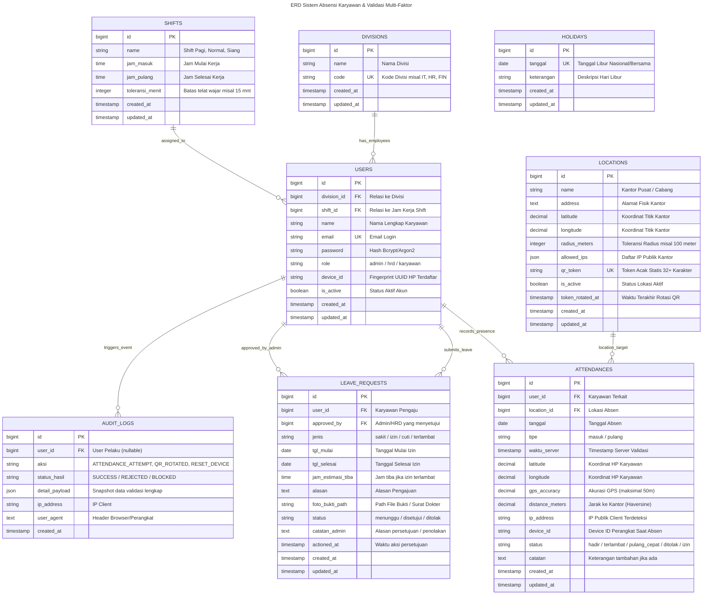

# Dokumentasi Rancangan Alur Sistem & Skema Database (Draw.io)

Dokumen ini berisi rancangan arsitektur, alur kerja sistem (workflow & validation gate), serta rancangan skema database (ERD) untuk **Sistem Absensi Karyawan Berbasis Web** yang mengimplementasikan scan QR statis, validasi GPS Haversine, IP publik kantor, dan device binding.

---

## 1. File Master Draw.io Multi-Page (Hitam Putih / Monochrome)

File draw.io master telah diperbarui dengan pemisahan total antara **Karyawan** dan **HRD / Manajer**:
**Path File**: [`c:\NAUFAL\ABSENSI\AbsensiPKL\LAPORAN\rancangan-diagram-sistem.drawio`](file:///c:/NAUFAL/ABSENSI/AbsensiPKL/LAPORAN/rancangan-diagram-sistem.drawio)

File tersebut berisi **9 tab halaman diagram mandiri** berformat **hitam-putih (monochrome)**:
1. **Halaman 1: ERD (Notasi Chen)** — Entitas persegi, relasi belah ketupat/diamond, atribut oval/elips (PK bergaris bawah), dan kardinalitas (1:N, N:1).
2. **Halaman 2: Use Case Diagram** — Boundary subsystem, aktor Karyawan, Manajer/HRD, Sistem Server, serta relasi use case.
3. **Halaman 3: Diagram Objek (Object Diagram)** — Snapshot runtime konkret instance objek (`u1 : User`, `divIT : Divisi`, `pres01 : Presensi`, dll.) dengan format rapi tanpa tumpang tindih.
4. **Halaman 4: Diagram Class (Class Diagram)** — 3-tier UML class boxes lengkap dengan atribut privat (`-`), metode publik (`+`), tipe data, dan multiplicity relasi.
5. **Halaman 5: Gambaran Sistem Diusulkan (Flowchart)** — Alur operasional sistem mulai dari login, branching role (Karyawan vs Manajer), validasi 8 lapisan server, hingga tiket presensi sukses / penolakan.
6. **Halaman 6: Activity - Karyawan** — Diagram aktivitas khusus Karyawan per fitur:
   - *Activity: Login Karyawan* (Karyawan | Sistem App)
   - *Activity: Presensi Masuk (Scan QR)* (Karyawan | Sistem App)
   - *Activity: Pengajuan Izin Karyawan* (Karyawan | Sistem App)
   - *Activity: Riwayat Presensi* (Karyawan | Sistem App)
7. **Halaman 7: Activity - HRD** — Diagram aktivitas khusus HRD / Manajer per fitur:
   - *Activity: Monitoring Presensi Realtime* (HRD / Manajer | Sistem App)
   - *Activity: Approval Izin Karyawan* (HRD / Manajer | Sistem App)
   - *Activity: Manajemen Token QR Kantor* (HRD / Manajer | Sistem App)
   - *Activity: Rekapitulasi & Cetak Laporan* (HRD / Manajer | Sistem App)
8. **Halaman 8: Sequence - Karyawan** — Diagram sekuensi khusus Karyawan per fitur:
   - *Sequence: Login Karyawan*
   - *Sequence: Logout Karyawan*
   - *Sequence: Presensi Scan QR*
   - *Sequence: Pengajuan Izin*
9. **Halaman 9: Sequence - HRD** — Diagram sekuensi khusus HRD / Manajer per fitur:
   - *Sequence: Approval Izin*
   - *Sequence: Monitoring Presensi Realtime*
   - *Sequence: Manajemen Token QR*
   - *Sequence: Cetak Laporan Rekap*

---

## 2. Tautan Interaktif Draw.io Online

Diagram di bawah ini telah dibuat dan dapat langsung dibuka serta diedit di browser menggunakan draw.io:

1. **[Buka Diagram Alur Sistem di Draw.io](https://app.diagrams.net/?grid=0&pv=0&border=10&edit=_blank#create=%7B%22type%22%3A%22mermaid%22%2C%22compressed%22%3Atrue%2C%22data%22%3A%22pVhZc%2BK6Ev41VGUeSBGzhPNoBCQESLgsM3XuS0q2BWhsbMZLcnJ%2F%2Fe1uyVgGOyR1qkK8Sb3p6%2B5PajabjZbtRuFW7hptG%2B4bVgv%2BAv4RZSm%2BsVoi8OF9k0Zug%2Bjd3fM4hffr4Wl4kjm7mB%2F3cDvl8Qd%2F5%2BE8cmQgGt1Bw7Lubo0PcHujP1qtX8KB%2F4M4ek9E%2FAOGNrqFVPVn3ygh8yzgUlk0yHx%2Bmmw7iQgTqeaCiBYY2h7hqMY9zlulPM0SeJ5FOxk22mMceX%2BuZaAm4r01EEF2OE2A0YVMpmwZR7ExwHCtwn5mTB%2Bq6avMOUgM4ejAZUDDevB%2FwZPkPYq9SjFDQ8xIeWZnqQhT6XP0vjUQ8R7ugjoPR4aHD3zHg3PP6oevMj8RSXn8WLky5MneiTga3Tqt6qfxGJQEe3xfHenx2bSzx7Ex9EGFYyEDicLmIswqI%2FBgaCbUwO0j92RMr1DiAjAW7sqGPCpHNeam%2FCBivLnZp4eg2%2FwTu5EnqpH7aEiZ6JV3KQH%2Bs8SIw0S4ID5lQqLDNIorJU0MSU9Kkn1wCDrTCBAjQ45welisTmCy%2FSxWwLh5EFEQuaAlQt32YlJt7pOhZKqUPIgQvE3FKUAD7qLzQ%2FEmXXw7luFOxMdYhmmlzKkhc6ZkTmUsD4T2jyDiiJvFy2qtNPAUEO3xEGWP3b1w%2FSamLHNiVN8e3fyJX9PIx5XDtArQa7rBRcMb7rrgtvuhnjwy81V61Q5%2FAo%2BFCHf8d0aLNfnfOTbnypMccE8ihAWkyrTiPiW2ipaaqR9YlsrTw1rEAT84vDpqc0PXs9I1oaWkukOK1oBTymH00w54wnVMxlEaNahEprJS%2BLMh%2FOWsHhUrEQj%2BplLeEABrg%2FcVVX8l4jcR%2F%2BSB9BTOSK51e%2FpEN7A2Mv3AUCtM3fQRFvwoyfqWmk6O%2FuK%2FpVO9ajPD%2Fp93KvVndzoqCht5frmRb4DHwzXFr7NIl0wbYrStq5cgu8DDGgzzyyBY3ikn11EAny7V6ynKq6%2Fgr6Twb17W9tPSnloaaII8QJzuspDrtC%2BcZavl%2BKS8zkPriofWhYda7fd9sz7zra19ayslC6g54c6nkgaJ4vFtymOzCpzKz0CGUPt2P2o9bJdyuhALzdIR3pkdy%2FaFv4%2BZk4U7wop3oGTOwjRD15ciESgpt6UiBrXa4T7lh4soOLrTKKcM2a0Jdn8f7zaJqG4RJWUK%2BmXxnYsJTvmzWoOOcnyyQDszJ5DoLAukwAoPUUCoedJYDTsATig8mmO0sZoVOTeicwnB1s2Qp5zAFmSBKLrzLOOKIxpL1rlYMiodDaIBlBo%2B5fwv2RzLxqdN9jPTLiDb1eHqKqVFt9U9uM0abVy0butQC85ule8gH%2Bacu9nVHBj6LEZmQzRFZaQMP7APaMUzcUBGhZ1AMxY7FlwlkkMvvuB59zPPe9rzntL%2FxGMy3BdGdAv%2Fl8CvgH0bybvMDkTHH6HBxIkMhTn8roW%2B1wWsdxmwUpR6F2AYSo2bwpRvYaD3WSTudSTu9a5EbxtyaqkqReH5Wh6R1qz2cgupNH7kMRr3QYQTiAPUgzq%2F7w0rcsqstZT8v7%2Bs13o0rD4QQCo%2BK%2BGgoYCaL0XA1K09LAWhr3TO%2Bkrh6I0HWd7D%2FTRrGATgLSG8YIxUEAxU5Dx8LY5kZT75jC6dU4J6RoI1xOGJsDMPqA3Z2EY6Ah2TIsEVM%2BsZQ6vrat%2FwdjjApn%2BDyyAPRxJBuF9ziClcC%2F5agnyit6CYlX7B1%2FER6yxe37W%2FCQUL3fxRsQcc3JWMsbQxTC9t2RZ0%2FDWIdlWmKHBsGButVjXKzh6XZdWzKEn%2Bnfbl6GnE1qOhJu5EYWtMWVqXus9GtK%2BO6Fwd0b06ond1xP21EWePL6XxrzOk3Z9CjIj5ayz%2BZCJJa4M7Hz1vnh8eNhcBrU8YIjj28RhHkMIqYTq3lB3FDj8nQSpvHpfD6qOK3I%2FCNXs413Q5FzEXsJGWfsJVTl7sti7PgVBESaKmxFNxzMBxmq2k19RRmmJ0ECqTpWoGIzQH3Bw9tUdZGVEdTtYvM3tK0%2FEYg%2BWFpNpcU9lKpNnvTF6o63yqbjVab542kzoFnbKs7gk4oR9HoSI%2Bp%2BOv0zkZ0revlizFBf87eW7kpXhlTyfr0xPbrCdfqx%2Fl2gXWvs5f9N52HoUSGrLivFOxx1ZAti8FD5qpPAjDMl2yRSp8tYcLowPsQhpGR6wAJCViWb39%2FDK3Z39rVALP1MzcjRyusKT7uD4s0x6f9H2xD42F8Bzu%2BqczMdLXvSX3kiMdyQy4otn%2B1cMzrPlGwx%2Bt7vTp6JofjjJQS%2F4cwbY2PxZU8VpLn3YreZstTvTwzPRKtECNVaFmIRJ9DTGTjIaan0cA5SI2amxTqxRS1pXU6SQ0joznIpB7xV9yQFOl0CwvzXP5WpqA8M53hSdF7tYvuQs%2BJ0OxxdVPxREuWxkEJKLtcdHfutDokjSOYJHpZc%2FtC2d7etl8l166h093t93jP432oEqyJ1yZqGO8Qvp2u7Xcc%2Blez%2Bl1e9%2BTnmQuVIGkbHpX9L3OmfC%2B5bR7FcKtWtGx%2BC3ctGx23xUXZjv9bqfb%2BmZQ1G6xkCzuwOr7M8l%2F9e7b%2FEpASsIROzAcyAlDjgK5zx7hB8WYPcEPugCbwW8OP6iODBo5oy01Q8bIVLdiCn2MijNdqOqpu7wAacCcO9ego3IGoGUPKBXF4TEKw50%2Bw90pw40awz0KQ5rOdMs5gaRCIlVhRlWE5XnOjH5NsayYh%2ByPIQ1jyLQYkimGfIkhJWJLrZ0%2BQbEoFrxKFBQtNa5jYI4G%2Fh8%3D%22%2C%22version%22%3A%2212%22%7D)**
2. **[Buka Diagram Skema Database (ERD) di Draw.io](https://app.diagrams.net/?grid=0&pv=0&border=10&edit=_blank#create=%7B%22type%22%3A%22mermaid%22%2C%22compressed%22%3Atrue%2C%22data%22%3A%22vVjbcuI4EP0aqmYfqGIzNTvPBszAhCEMNpnaJ1djK0b4upJMlv367ZZ8TYyTyVwqKSzZ6mOp%2B%2FTN4%2FF4NLEUVzEbvbdGN5PRzY29m%2BPA4VKxBAfWQbJUchzdgrjAI6R62V%2F4ew8xD0A%2F%2B1LEio8XEKlMIAaCjjU0E3MOoYAEx1puMl%2Fdr5zV3cah6ccZ%2Fo%2FH2ejjFKd7x97p29VWjiA9luRxdmFMGlgD4ixXC%2Fc1CCAlD1MWeCpry9fruuKW69qbubWZ2R0QwfxMBNLLBUNd%2BKyNtL6bWW7%2Fca6gxZkPimepp0CETL1iW2vbure9nf11bztuB0sWh4Qr6cUMzuyHkCDPRXZGRR0uHgQJT1%2Bjrv185Xrru08dJCV4GDKBljuztDpev%2FWn9X3zf%2BAhJ5EJD%2FBne%2FvksUToNMRBCgkzL9tAAgTLz5x4eHNNws8CktjfGrFbM63EJgmXEON15Y5uZnhd7sx1sdo8B1U8YVJBkhOuYKBQa6AGFhV58GzRx3lbLS0%2B%2F7hOnCN%2FIIEthNwcY5OJhM43044NtL7vUHg5QeIlIIvIQH2GxDg36ADAxAkGRXNcqXdTyzosZnJIGg%2FHkC6Ek8VMAMYaL2EpVwZlCgokPWQx0K1HOIFoWezPDzRJ1W8xU%2BMH32ml%2BnGgGYfOr9ctSjru8HCah1GblU8PVINIMvAQglF9qfBJyYervvHMm9YsDSMglTQh%2F6o0S4DHLdeyy%2Fk6C%2FmQXI6h%2BRHDqpFagjziaOqLS457XVgizNKbAXGBZDGiZbTC4QJ%2FjyUijaOXdx%2BwM%2FeZ0SUuW%2BBdJnJh9LzfrygVLrf44zIRwIMC0WOXDPei0yKXHviKnytHVKAKIq8VKf6gr0XPZn4BUbtZ6cdDyi2kOrFPtoUEVSt4Bof%2BYML%2BpUUQBJgxpYGwYiQX3V0guSPNrbQuFtrCAfO5jlYT9HiuiqDaQ4Zs4anGcLl6LUaWhm8EaSKTgIAXEsOSwrxmgNwqWOF0px%2BPWkFpQvJ6%2BXPYk8yIKxDH2SMakecl4ryk12S11Yo%2BxIO7q630j8DiJmJpywfdcm75QBDEQ05veY8eNTVujZVa3%2BZe5vI6i0ykKUk9xGa9L09kqqKrhvqG7y6MS0F05HTkHS7RoF93v8U%2FnpRmbw7nhWSiG4hbRTKeLwLeE3lr8boU7EA0GqbSu4fceDg6MbpeqOlGFq8nV4RquiielyZt8jz5cpW6h7T%2FSJbz8Mxn7Rb03tZTp7rf9AVv8W0dbq8nnle59qsxwpxo7hcC%2FIuBwRgtjPo%2FbYkc7xKIZLn6wyT5YwgtwKYJsEHoRIrP5GyjMjPXgfTdEit2IXnKehBrY%2FHc6wTRbmiYxVxX2Do54RujwRL4Saqb6ymOdY7bUjDDpE9oDujLS0SSVUTQjVrARU0lPDsG%2B0MrURhyeT7LWzcDjhUfNAzk%2F%2FUVDGUuQUfBv7Q0NakXAfVc0auOenjiEdUvEFypUn92ln3WTf2aQLLFegxOxUAgaXVvLQjLVEaLpe7oL6Yyx9r6wlRxKoa4csICvDSthIg3NjM2Kid%2BoXif0a8FrDD2krKV6ISsqr9Y9RKgJS3rZqIj3%2FQY%2FQitBgWti76KLYbiB6j8M9Fr9LxkUHnMgTNVJQ6W3RUrrWpc2muw8HzIVOYdCsyhHvrE0SBszWjBdW07pae1fh0MS%2FTGedafuXv9Eo1doJaKls%2FJyvhPvXDY8bymzG4OmmME03DQkCJnKeH1Hb7tXVRbZGlPVQA6inWhf0dF0PmW8RP9eC91TtxigxbR%2Bd6lRRzDIR6M%2B6USSNd1peLR8Mu2%2FELxdeft7lzLtedmvrMd2%2FXm9v1qZr9IDu%2BILlBWDs5%2BhlWQU9tvZ3%2B2Zxq2vDHFZuKW5lcKWcw82PEhiy9xBmVycVLI5TFTxn3Jo87Nt8K4ai%2B%2FL%2B1V2e4KT7XmITQJkTpKBoHW%2FFRkj9oGi1aS%2B15GdcmyvFuv5tbfb6LKs%2BqtLtrrO2t%2BKGjnG6BPBXRrMUV30M35VZ1F7Zyo87uMBDYXpPElCN7g%2Fjpv%2Bh8%3D%22%2C%22version%22%3A%2212%22%7D)**

---

## 2. Diagram Alur Sistem (Workflow & Validation)

```mermaid
---
config:
  layout: elk
---
flowchart TD
  subgraph KaryawanMobile["1. Karyawan (Mobile Web Browser)"]
    A(["Mulai: Buka Web Absensi"]) --> B{"Status Login?"}
    B -- "Belum Login" --> C["Form Login Karyawan"]
    C --> D["Submit Email & Password"]
    D --> E{"Autentikasi Berhasil?"}
    E -- "Gagal" --> C
    E -- "Sukses" --> F["Dashboard Mobile Karyawan"]
    B -- "Sudah Login" --> F
    
    F --> G{"Pilih Menu"}
    G -- "Absen Hadir / Pulang" --> H["Buka Kamera (html5-qrcode)"]
    H --> I["Scan QR Code Statis Kantor"]
    I --> J["Ambil Koordinat GPS & Akurasi (Geolocation API)"]
    J --> K["Generate / Baca Device Fingerprint"]
    K --> L["Kirim Payload POST /attendance/check-in<br/>(qr_token, lat, lng, accuracy, device_id)"]
    
    G -- "Pengajuan Izin" --> M["Pilih Jenis: Sakit / Izin / Cuti / Terlambat"]
    M --> N["Isi Form: Tanggal, Alasan, Foto Bukti"]
    N --> O["Submit POST /leaves"]
  end

  subgraph ServerValidation["2. Server Security Gate (8 Lapisan Validasi Wajib)"]
    L --> V1{"L1: Token QR Cocok<br/>dengan Lokasi Aktif?"}
    V1 -- "Tidak" --> R1["Tolak: Token QR Tidak Valid"]
    
    V1 -- "Ya" --> V2{"L2: Sesi Pengguna &<br/>CSRF Valid?"}
    V2 -- "Tidak" --> R2["Tolak: Sesi Tidak Valid"]
    
    V2 -- "Ya" --> V3{"L3: Perangkat Terdaftar<br/>(Device Binding)?"}
    V3 -- "Perangkat Berbeda" --> R3["Tolak: Hubungi Admin untuk Reset Device"]
    V3 -- "Perangkat Pertama" --> V3b["Binding Device ID ke User"]
    V3 -- "Cocok" --> V4
    V3b --> V4{"L4: IP Publik Client Ada di<br/>Allowed IPs Kantor?"}
    
    V4 -- "Tidak (Data Seluler / Luar)" --> R4["Tolak: Wajib Menggunakan Wi-Fi Kantor"]
    
    V4 -- "Ya" --> V5{"L5: Akurasi GPS <= 50m?"}
    V5 -- "Tidak (>50m)" --> R5["Minta Ulang: Sinyal GPS Lemah, Buka Area Terbuka"]
    
    V5 -- "Ya" --> V6{"L6: Jarak ke Kantor <= Radius<br/>(Rumus Haversine <= 100m)?"}
    V6 -- "Tidak" --> R6["Tolak: Di Luar Radius Kantor"]
    
    V6 -- "Ya" --> V7{"L7: Belum Absen untuk<br/>Tipe/Shift/Hari yang Sama?"}
    V7 -- "Sudah Absen" --> R7["Tolak: Sudah Tercatat Sebelumnya"]
    
    V7 -- "Belum" --> V8["L8: Evaluasi Waktu Server vs Jam Shift<br/>(Hadir Tepat Waktu / Terlambat)"]
  end

  subgraph DatabaseAudit["3. Pencatatan & Database"]
    V8 --> DB1[("Simpan ke Tabel attendances<br/>(status, koordinat, IP, waktu server)")]
    DB1 --> DB2[("Catat ke Tabel audit_logs<br/>(status: SUCCESS)")]
    
    R1 --> DBLoss[("Catat ke Tabel audit_logs<br/>(status: REJECTED, alasan)")]
    R2 --> DBLoss
    R3 --> DBLoss
    R4 --> DBLoss
    R5 --> DBLoss
    R6 --> DBLoss
    R7 --> DBLoss
    
    O --> DB_Leave[("Simpan ke Tabel leave_requests<br/>(status: MENUNGGU)")]
  end

  subgraph AdminApproval["4. Dashboard Admin & HRD"]
    DB_Leave --> ADM1["Admin Memeriksa Pengajuan Izin"]
    ADM1 --> ADM2{"Keputusan Admin?"}
    ADM2 -- "Tolak" --> ADM3["Update Status: DITOLAK + Catatan"]
    ADM2 -- "Setujui" --> ADM4["Update Status: DISETUJUI"]
    ADM4 --> ADM5[("Sinkronkan Status Absensi di Tabel attendances<br/>(status: IZIN / SAKIT / CUTI)")]
    
    DB1 --> ADM_MON["Monitoring Kehadiran Real-time<br/>& Deteksi Anomali Absen"]
    DBLoss --> ADM_ANOMALY["Alert Percobaan Absen Gagal / Anomali"]
  end

  subgraph FeedbackKaryawan["5. Respon Balik ke Karyawan"]
    DB2 --> RES1(["Tampilkan Notifikasi & Tiket Hadir Sukses"])
    DBLoss --> RES2(["Tampilkan Pesan Penolakan & Alasan Ramah Pengguna"])
    ADM3 --> RES3["Karyawan Melihat Status Izin: Ditolak"]
    ADM4 --> RES4["Karyawan Melihat Status Izin: Disetujui"]
  end

  classDef step fill:#dae8fc,stroke:#6c8ebf,stroke-width:1.5px;
  classDef decision fill:#fff2cc,stroke:#d6b656,stroke-width:1.5px;
  classDef success fill:#d5e8d4,stroke:#82b366,stroke-width:2px;
  classDef reject fill:#f8cecc,stroke:#b85450,stroke-width:1.5px;
  classDef data fill:#e1d5e7,stroke:#9673a6,stroke-width:1.5px;

  class A,C,D,F,H,I,J,K,L,M,N,O,V3b,V8,ADM1,ADM4,ADM5,ADM_MON,ADM_ANOMALY step;
  class B,E,G,V1,V2,V3,V4,V5,V6,V7,ADM2 decision;
  class DB1,DB2,DBLoss,DB_Leave data;
  class R1,R2,R3,R4,R5,R6,R7,ADM3,RES2 reject;
  class RES1,RES4 success;
```

### Penjelasan 8 Lapisan Validasi Server:

| No | Lapisan Validasi | Mekanisme & Parameter | Tindakan Bila Gagal |
|---|---|---|---|
| 1 | **Validasi Token QR** | Membandingkan token hasil scan dengan `locations.qr_token` yang aktif di database | Ditolak, catat ke audit log |
| 2 | **Validasi Sesi & CSRF** | Memastikan user telah login dan token CSRF valid | Ditolak (Error 401/419) |
| 3 | **Device Binding** | Memeriksa kecocokan `device_id` pengirim dengan `users.device_id`. Jika baru pertama kali login, sistem mengikat device tersebut. Jika beda, akses diblokir. | Ditolak, tampilkan petunjuk reset device ke admin |
| 4 | **Validasi IP Publik** | Mengecek `request()->ip()` apakah terdaftar di field `locations.allowed_ips` (Wi-Fi kantor) | Ditolak (mencegah absen dari luar kantor/data seluler) |
| 5 | **Validasi Akurasi GPS** | Memeriksa nilai parameter `accuracy` dari browser, toleransi maksimal `50 meter` | Minta user mencoba kembali di area terbuka |
| 6 | **Jarak Radius Kantor** | Menghitung jarak Haversine antara koordinat HP dengan koordinat kantor. Wajib `<= locations.radius_meters` (misal 100m) | Ditolak, tampilkan selisih jarak aktual |
| 7 | **Cek Duplikasi Shift** | Memeriksa apakah user sudah memiliki record kehadiran untuk shift dan hari yang sama | Ditolak agar tidak terjadi pencatatan ganda |
| 8 | **Penentuan Status Waktu Server** | Membandingkan jam server saat request diterima dengan jam shift (`shifts.jam_masuk` + `toleransi_menit`) | Menentukan status: `Hadir` atau `Terlambat` |

---

## 3. Diagram Skema Database (ERD)

### Kamus Data & Relasi Tabel:

1. **`users`**
   - Menyimpan kredensial, peran (`admin`, `hrd`, `karyawan`), relasi divisi & shift, serta `device_id` untuk binding gawai karyawan.
2. **`divisions`**
   - Mengelompokkan karyawan per unit kerja/departemen.
3. **`shifts`**
   - Menentukan jam kerja, jam pulang, dan toleransi keterlambatan (menit).
4. **`locations`**
   - Menyimpan titik koordinat kantor (`latitude`, `longitude`), radius geofence (`radius_meters`), daftar IP kantor (`allowed_ips` dalam format JSON array), serta `qr_token` statis 32+ karakter acak.
5. **`attendances`**
   - Transaksi kehadiran harian lengkap dengan jejak audit forensik: koordinat GPS saat absen, jarak terhitung ke kantor, akurasi sinyal, IP client, device id, dan status waktu server.
6. **`leave_requests`**
   - Pengajuan izin/sakit/cuti/terlambat oleh karyawan beserta bukti foto dan persetujuan bertingkat oleh HRD/Admin.
7. **`audit_logs`**
   - Mencatat seluruh jejak percobaan sistem (termasuk anomali dan penolakan absen gagal) demi integritas data dan deteksi kecurangan.
8. **`holidays`**
   - Kalender hari libur nasional untuk membedakan hari kerja vs hari libur pada rekap alpa otomatis.
